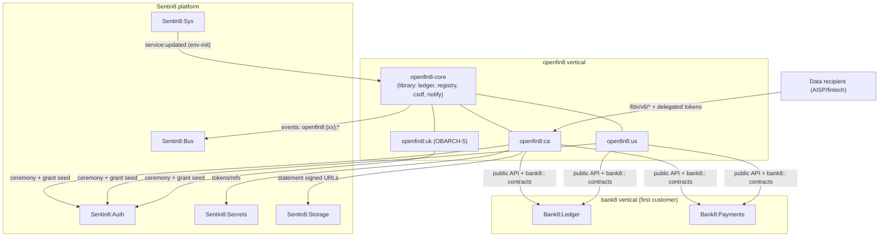

# openfin8 - Detailed Design Document

> The open-finance vertical: architecture, boundaries, and the
> composition contract. Per-service wire-level design lives in each
> repository's `DESIGN.md` (OBARCH-1..5); this document is the
> vertical rollup.

## 1. Scope & Context

**What this vertical is.** The consent and data-sharing layer of the
Sentin8 platform, split out of bank8 (OBVERT-1,
`design/sentin8-openfin8-vertical-split-design.md`) because the
standards it serves moved from open banking to open finance: the
layer's data sources are cross-sector and banking is its first
sector, not its container. One kernel (`openfin8-core`) + thin
per-jurisdiction adapters.

**What it owns**: the consent ledger (provider grant ledger), the
recipient registry (two-ledger model), CSDF data minimization, the
notification delivery worker, the per-jurisdiction provider wires,
the provider catalog, and the certification-evidence surfaces.

**What it does NOT own** (the OBVERT boundary): any other vertical's
database or schemas - bank8's Ledger/Payments are consumed via their
public APIs and the `bank8::` SDK contracts (accounts, statements via
signed URLs, money-movement initiation); statement bytes
(Sentin8:Storage); the OAuth ceremony hosting (Sentin8:Auth - OpenFin8
drives it per jurisdiction profile); identity, events, workflows,
scheduling (the platform).

## 2. The Vertical Identity

| Aspect | Value |
|---|---|
| Vertical / org | `openfin8` / [OpenFin8](https://github.com/OpenFin8) |
| Service types | `openfin8:ca`, `openfin8:us`, `openfin8:uk` (+ future `br/eu/au`) |
| Database (DBX §6.6) | `openfin8` (database-per-vertical) |
| Schemas (schema-per-service) | `openfin8_ca`, `openfin8_us`, `openfin8_uk` |
| Env prefixes | `OPENFIN8_CA_*`, `OPENFIN8_US_*`, `OPENFIN8_UK_*` |
| Event families | `openfin8:ca:*` etc. (grammar `openfin8:{xx}:{resource}:{operation}`) |
| OAuth scopes | `openfin8:{xx}:consents:read`, `openfin8:{xx}:accountbasic:read`, ... |
| Stream families / workloads | `openfin8-ca` etc. |
| PG roles | `openfin8_{xx}_service` (bypass_rls=false) |
| Kernel pin tags | `openfin8-v*` |
| Admin flag / service flags | `openfin8-ca` etc. (`sys.services` enablement) |

**Runtime identity derives from one `Profile` per jurisdiction**
(`openfin8-core/src/profile.rs`): every env var, scope, event, schema,
workload, and UI string routes through it - adding a market is a
constructor + an adapter binary, not a code fork.

## 3. The Two-Ledger Model (unchanged from the original design)

The provider's grant ledger (`openfin8_{xx}.consents`, seeded from
`sentin8:auth:grant:created`) and the recipient's consent registry
(`openfin8_{xx}.recipient_consents`, written by the recipient-side
consent-start/callback) live in DIFFERENT tenants. No SQL spans them.
Either institution may run any technology - the only contract is
standards-based OAuth at the provider's AS.

## 4. Per-Environment Configuration

Two layers, per the platform's model:

1. **Service enablement** - `sys.services` rows (`openfin8:{xx}`,
   `enabled`, `config` JSONB) per (org, env); the
   `sentin8:sys:service:updated` consumer reacts per adapter
   (provider-profile seed, per-env policy-set seed).
2. **Version selection** - `OPENFIN8_{XX}_VERSION` (default 6.5)
   drives the `/fdx/v{major}` mounts, capability announcements, admin
   selectors, and the provider-profile seed. Precedence:
   `sys.services.config` → env var → profile default.

## 5. Spec Publication (OBARCH-2)

| Adapter | Policy | Effect |
|---|---|---|
| `openfin8-ca`, `openfin8-us` | CustomerSupplied | published spec = OpenFin8-owned routes only (drift guard asserts zero `/fdx/` paths); the licensed FDX spec is supplied by the customer under gitignored `specs/` |
| `openfin8-uk` | Vendored-MIT-OBL | OB paths may publish with the OBL notice |

## 6. Failure Modes & Invariants

Carried from the OBARCH set unchanged: the consent middleware
chokepoint; terminal revocation; secret references only;
same-transaction tenant discipline; no cross-tenant SQL; profile
isolation (an adapter cannot mount another jurisdiction's routes).
**New (OBVERT)**: OpenFin8 never imports another vertical's database
or internal schemas - public API + SDK contracts only; conversely
bank8 reaches OpenFin8 via BFF service calls only.

## 7. Roadmap

- **OBARCH-5** (`openfin8:uk`): FAPI 1 Advanced ceremony (client-
  credentials intent staging + hybrid flow + request objects),
  intent-based consents over core's `awaiting_authorization` state,
  `{Data, Links, Meta}` envelope codec, detached JWS signing, OB
  Directory trust, VRP, event-notification API. Auth gains the FAPI
  profile flag alongside.
- **BR / EU / AU adapters**: designed (research set); each lands as a
  thin profile + wire family per the same contract.

---

**Architecture & Design:** openfin8 and its underlying concepts were
designed by [Hamid Jahanzad](https://www.linkedin.com/in/hamidjahanzad/).