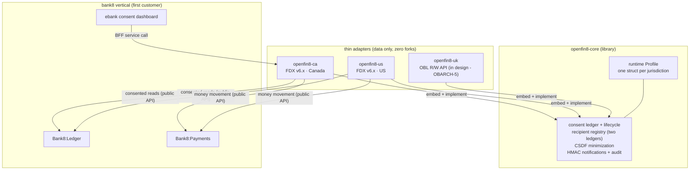

# OpenFin8 - Open Finance Vertical

**Website: [openfin8.dev](https://openfin8.dev/)** - the full documentation lives there.

**Secure Post-Quantum-Safe Consent-First Open Finance Platform That Heals and Scales Itself.**

Consent-first financial data sharing for every jurisdiction - US,
Canada, UK, with Brazil, EU, and Australia designed on the same
contract.

OpenFin8 is the open-finance vertical of the Sentin8 platform: the
consent authority, recipient registry, and jurisdiction adapters that
let an institution share its customers' financial data with
registered third parties under explicit, revocable, field-minimized
consent. Banking is its first sector: bank8 (or any vertical) composes
the provider role; recipient-only fintechs compose the recipient plane
standalone.

## Why a separate vertical

The standards moved from open banking to open finance - FDX added
payroll data and targets agentic-AI data sharing (US), the UK's Future
Entity is chartered for Open Finance/Smart Data, Brazil's phases 4-5
cover investments/insurance/pensions, the EU's successor standard IS
the "openFinance API Framework", and Australia's CDR is
sector-agnostic by legislation. The consent layer's data sources are
cross-sector; banking is its first customer, not its container. The
split makes the recipient plane independently sellable and gives
every future data family one home.

## The architecture

**One kernel, thin adapters.** The entire implementation - consent
ledger, recipient registry, CSDF engine, notification worker, provider
wire - lives in `openfin8-core`, shared byte-for-byte. Each adapter
contributes its [`Profile`](openfin8-core/src/profile.rs) (service
type, scope vocabulary, schema, env prefix, standard version), its
registration data, and its published-spec policy. The US and Canadian
adapters are the same code with different data; the UK adapter (OBARCH-5)
adds the OBL wire family over the same kernel.

**The two-ledger model** carries over unchanged from the original
design: the provider's grant ledger and the recipient's consent
registry live in separate tenants, no cross-tenant SQL ever, and each
institution's instance serves whichever role its environment plays.

## Services

| Service | Jurisdiction | Standard | Status |
|---|---|---|---|
| `openfin8-core` | - | - | kernel library (tagged `openfin8-v*`) |
| `openfin8:ca` | Canada | FDX v6.x (consumer-driven banking) | serving |
| `openfin8:us` | United States | FDX v6.x | serving |
| `openfin8:uk` | United Kingdom | OBL Read/Write API v3.1.x | in design (OBARCH-5) |
| `openfin8:br` | Brazil | Open Finance Brasil | designed (BR profile on the kernel) |
| `openfin8:eu` | European Union | Berlin Group openFinance | designed |
| `openfin8:au` | Australia | CDR | designed |

## Specification licensing (the OBARCH-2 policy)

The FDX API specification (US/Canada) is licensed under the FDX API
License Agreement and distributed exclusively by FDX - **never
published** by these repositories. Each adapter's published
`docs/openapi.json` carries OpenFin8-owned routes only, enforced by a
CI drift guard; customers supply their licensed FDX specification under
gitignored `specs/fdx/{version}/`. The OBL (UK) specifications are MIT
Open Licensed and may be vendored with the notice. Brazil's specs are
public; the EU OpenAPI files are CC BY 4.0; Australia's CDR standards
are MIT.

## Cross-vertical composition

OpenFin8 consumes bank8's data plane (Ledger, Payments) via **public
APIs and the `bank8::` SDK contracts only** - never bank8's database
or schemas (the OBVERT invariant). The bank composes the provider role
by enabling `openfin8:ca` in its environment (`sys.services`); the
ebank consent dashboard reaches it through the BFF like any service.

## Repositories

| Repo | Purpose |
|---|---|
| [`OpenFin8/openfin8-core`](https://github.com/OpenFin8/openfin8-core) | the kernel library |
| [`OpenFin8/openfin8-ca`](https://github.com/OpenFin8/openfin8-ca) | the Canadian adapter |
| [`OpenFin8/openfin8-us`](https://github.com/OpenFin8/openfin8-us) | the US adapter |
| [`OpenFin8/openfin8-uk`](https://github.com/OpenFin8/openfin8-uk) | the UK adapter |
| [`OpenFin8/openfin8-br`](https://github.com/OpenFin8/openfin8-br) | the Brazil adapter (designed) |
| [`OpenFin8/openfin8-eu`](https://github.com/OpenFin8/openfin8-eu) | the EU adapter (designed) |
| [`OpenFin8/openfin8-au`](https://github.com/OpenFin8/openfin8-au) | the Australia adapter (designed) |
| [`OpenFin8/openfin8-eopenca`](https://github.com/OpenFin8/openfin8-eopenca) | eOpenCA - the recipient app |
| [`OpenFin8/openfin8-e2e`](https://github.com/OpenFin8/openfin8-e2e) | the recipient-journey e2e suite |
| [`OpenFin8/openfin8-site`](https://github.com/OpenFin8/openfin8-site) | this site (openfin8.dev) |

## Apps

- **eOpenCA** ([`OpenFin8/openfin8-eopenca`](https://github.com/OpenFin8/openfin8-eopenca))
  - the recipient app (formerly bank8's eFintech): the consent-first
  fintech onboarding + account-aggregation experience for the Canadian
  plane. A Flutter thin client - all backend access rides the BFF;
  recipient consent bookkeeping lives in the recipient's own tenant.

---

**Architecture & Design:** OpenFin8 and its underlying concepts were
designed by [Hamid Jahanzad](https://www.linkedin.com/in/hamidjahanzad/).